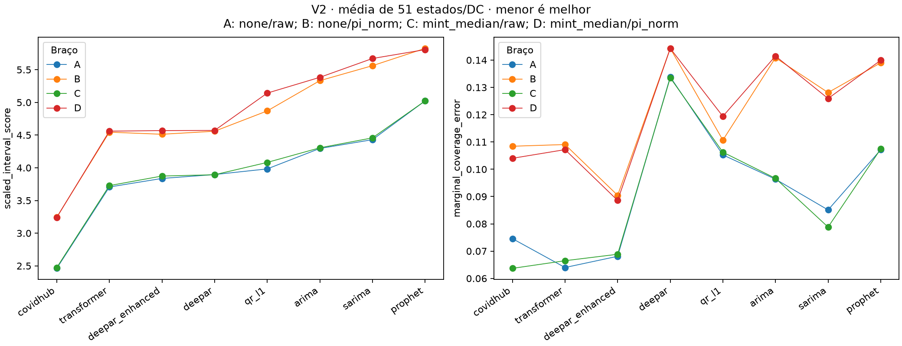
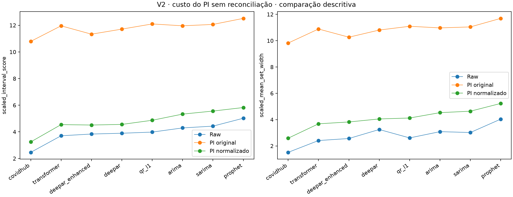

# Benchmark v2: o que melhorou em relação a v1

**V2 melhora a instrumentação, reduz o custo excessivo do PI original e amplia a qualidade dos candidatos gerados, mas não supera o COVIDhub nem demonstra um benefício geral da reconciliação.** O Transformer tem o menor score bruto entre os modelos gerados (3,7062), cerca de 5,0% abaixo do melhor gerado de v1 (DeepAR, 3,9008). Ainda assim, seu score é 50,5% maior que o do COVIDhub (2,4619). O PI normalizado reduz o score em 53,5%–69,9% frente ao PI original dentro de v2, mas aumenta o score em todos os oito modelos frente às previsões brutas sem reconciliação. A única melhora de score atribuível à reconciliação com suporte no bloco principal é pequena e específica ao Prophet já submetido a PI normalizado.

Esta análise de resultados atende ao pedido de comparação de 2026-10-25. O [registro de readiness](model-benchmarks-v2-protocol-readiness.md) permanece um registro técnico: sua aprovação, os testes e a publicação não constituíam aprovação prévia de uma conclusão científica. As interpretações abaixo são exploratórias, condicionais a esta execução e às limitações D15. Nenhuma configuração, semente, regra de avaliação ou saída do experimento foi alterada.

## 1. Perguntas e hipóteses avaliadas

| Pergunta | Evidência observada | Conclusão neste benchmark |
|---|---|---|
| Os novos modelos melhoram os candidatos de v1? | Transformer e DeepAR enhanced têm scores brutos menores que o DeepAR original; QR-L1 supera ARIMA/SARIMA, mas Prophet não | Avanço descritivo de candidatos; não há teste registrado entre modelos gerados ou entre versões |
| Algum gerado supera o COVIDhub no mesmo braço? | Os 28 contrastes de score gerado menos referência são positivos e Holm-significativos no bloco 8 | Não; todos têm score pior, nos quatro braços |
| Normalizar PI corrige a expansão excessiva do PI original? | Score e largura física muito menores que com PI original; menos conjuntos vazios | Sim, descritivamente; normalização e mudança de KI compõem a mesma intervenção |
| PI normalizado melhora a previsão bruta? | B−A aumenta o score nos oito modelos, com suporte nos três blocos | Não para o score médio dos estados/DC |
| Reconciliação melhora de forma geral os endpoints? | C−A sem suporte; D−B depende do modelo; nenhuma melhora de erro marginal com suporte | Não; a exceção de score é pequena e restrita ao Prophet |

## 2. Metodologia e comparabilidade

As fontes primárias são as tabelas imutáveis de v2 e o bundle de v1 disponível em `/home/vinvs/projects/research/pid-control-ts/results/model-benchmarks-v1/`. O relatório e os quatro PDFs de v1 em `docs/analysis/figures/` dão o contexto histórico. Os gráficos novos abaixo foram calculados das tabelas de v2; os PDFs históricos não foram modificados.

Ambas as versões usam o mesmo arquivo de mortes revisadas, horizonte de quatro passos, 57 nós e a mesma janela de 63 alvos semanais, **2021-12-25 a 2023-03-04**. O endpoint é a média sem pesos dos 51 estados/DC; os cinco territórios participam da hierarquia, mas não desse endpoint. V2 gera 86 origens por modelo, totalizando 602 lotes para sete modelos, além da referência externa.

Os quatro braços principais de v2 são:

| Braço | Reconciliação | Controlador |
|---|---|---|
| A | `none` | `raw` |
| B | `none` | `pi_norm` |
| C | `mint_median` | `raw` |
| D | `mint_median` | `pi_norm` |

Os demais oito cruzamentos por modelo, incluindo `mint_shrink`, `bottom_up` e PI original, são descritivos. Isso muda o foco de v1, cujo relatório enfatizava MinT(Shrink) e o PI original. Uma conclusão sobre `mint_median` em v2 não é uma replicação do contraste principal de MinT(Shrink) em v1.

**As métricas de cobertura também mudam.** O `coverage_deviation` histórico mede desvio de cobertura em janelas móveis de dez semanas. O endpoint principal novo, `marginal_coverage_error`, é a média de `|cobertura do nó nas 63 semanas − 0,8|`, calculando o valor absoluto antes de agregar nós. Assim, os 0,1336 de COVIDhub em v1 não devem ser comparados aos 0,0746 do erro marginal em v2 como uma redução de erro. A cobertura de 85,40% pode coexistir com erro médio de 0,0746 porque erros positivos e negativos entre nós não se cancelam nesse endpoint.

O score é a fórmula registrada para o par de quantis, dividido em cada nó por `max(média |y|, 1)` na janela avaliada e depois agregado entre nós. A escala do score é diferente da escala do controlador `pi_norm`: esta última fica fixa a partir do prefixo anterior à avaliação. O PI normalizado usa `KI=1`, enquanto o original usa `KI=1000`; o contraste descritivo entre eles não isola apenas uma mudança de unidade.

A inferência registrada é bootstrap pareado por blocos móveis não circulares, 2.000 reamostragens, bloco principal 8 e sensibilidades 4 e 12. Holm é aplicado separadamente a 96 testes de intervenção e 56 de comparação com referência, por bloco. Os intervalos de 95% são pontuais, sem ajuste simultâneo. Os valores de p citados abaixo já são ajustados, salvo indicação explícita. A resolução mínima do p não ajustado é `1/2001`; os valores recorrentes 0,047976 e 0,027986 decorrem desse piso e dos tamanhos das famílias. Valores iguais não significam efeitos de igual magnitude, e 0,047976 permanece próximo do limiar de 0,05.

## 3. Melhorias na qualidade dos modelos

Sem reconciliação ou PI, os resultados de v2 são:

| Modelo | Score escalado ↓ | Erro marginal ↓ | Cobertura | Largura física escalada |
|---|---:|---:|---:|---:|
| COVIDhub | 2,4619 | 0,0746 | 85,40% | 1,5121 |
| Transformer | 3,7062 | 0,0640 | 85,22% | 2,4103 |
| DeepAR enhanced | 3,8369 | 0,0681 | 77,12% | 2,5645 |
| DeepAR original | 3,8964 | 0,1338 | 93,18% | 3,2493 |
| QR-L1 local | 3,9829 | 0,1053 | 71,99% | 2,6094 |
| ARIMA | 4,2956 | 0,0964 | 89,26% | 3,0860 |
| SARIMA | 4,4298 | 0,0851 | 86,37% | 3,0200 |
| Prophet | 5,0226 | 0,1071 | 86,87% | 4,0371 |

O Transformer reduz descritivamente o score em 4,9% em relação ao DeepAR original da própria v2. O enhanced reduz esse score em 1,5%, mas melhora mais claramente o equilíbrio entre cobertura e largura: o erro marginal cai de 0,1338 para 0,0681 e a largura cai de 3,2493 para 2,5645. Isso não demonstra superioridade estatística entre os gerados: essa família de testes não foi registrada. O Transformer e o enhanced têm erro marginal bruto numericamente menor que o COVIDhub, porém suas diferenças ajustadas contra a referência não têm suporte (ambos p=1 no braço A).

**O COVIDhub mantém a vantagem de score.** No braço A, as penalidades gerado menos referência são +1,2444 para Transformer, +1,3751 para enhanced e +1,4345 para DeepAR original. Todos os sete gerados têm score pior em A, B, C e D, com p=0,027986 nos 28 contrastes do bloco 8. A mesma conclusão se mantém nos blocos 4 e 12. Nenhum modelo gerado tem melhora de erro marginal contra o COVIDhub com suporte após Holm; o DeepAR original tem erro maior nos quatro braços (p=0,027986 no bloco 8).



As linhas apenas conectam categorias de modelos para facilitar a leitura; não representam uma trajetória temporal ou uma escala contínua de complexidade. Células próximas no gráfico não estabelecem equivalência.

Na comparação direta entre bundles, as previsões base de ARIMA, SARIMA e COVIDhub são numericamente idênticas, e as 16 células agregadas compartilhadas por modelo (dois níveis × quatro reconciliadores × dois controladores antigos) têm os mesmos scores. O DeepAR original apresenta pequenas diferenças nos scores agregados: 3,9008 em v1 contra 3,8964 em v2 no braço bruto dos estados/DC, mas diferenças de quantis individuais chegam a 2.742,14 mortes no grid compartilhado. V1 usou CPU e v2 CUDA; não se deve atribuir essa diferença a uma melhora de arquitetura nem presumir reprodução numérica entre dispositivos. Não foi realizado teste pareado entre versões.

## 4. O PI normalizado melhora o PI original, mas ainda piora o score bruto

Comparação descritiva dentro de v2, sem reconciliação:

| Modelo | Score raw | Score PI original | Score PI normalizado | Redução frente ao PI original |
|---|---:|---:|---:|---:|
| COVIDhub | 2,4619 | 10,7900 | 3,2438 | 69,9% |
| Transformer | 3,7062 | 11,9594 | 4,5447 | 62,0% |
| DeepAR enhanced | 3,8369 | 11,3319 | 4,5127 | 60,2% |
| DeepAR original | 3,8964 | 11,7122 | 4,5590 | 61,1% |
| QR-L1 local | 3,9829 | 12,0997 | 4,8695 | 59,8% |
| ARIMA | 4,2956 | 11,9606 | 5,3325 | 55,4% |
| SARIMA | 4,4298 | 12,0635 | 5,5612 | 53,9% |
| Prophet | 5,0226 | 12,5183 | 5,8257 | 53,5% |

As larguras físicas médias escaladas também caem 55,3%–73,7% frente ao PI original. Isso enfrenta diretamente a expansão de intervalos destacada em v1. Entretanto, em relação a raw, o PI normalizado **aumenta** o score entre 16,0% e 31,8%. Os oito contrastes B−A têm suporte nos três blocos (p=0,047976). No bloco 8, as estimativas vão de +0,6626 no DeepAR a +1,1314 no SARIMA; para COVIDhub são +0,7820, IC pontual [0,6339; 1,0602]. Combinar reconciliação e PI também aumenta o score contra A nos oito modelos, com suporte nos três blocos.



O erro marginal B−A aumenta numericamente nos oito modelos. Para o COVIDhub, o aumento de +0,0339 tem suporte no bloco 8 (p=0,047976), mas não nos blocos 4 (p=0,111944) e 12 (p=0,060970). A conclusão de piora de score é mais estável que essa conclusão de cobertura. A cobertura média de QR-L1 passa de 71,99% para 91,07%, ultrapassando a meta de 80%; seu erro marginal médio também aumenta, de 0,1053 para 0,1107. Aumentar cobertura não equivale a melhorar calibração.

Conjuntos vazios continuam visíveis: há **1.542 linhas com `lo > hi`**, das quais 1.515 no PI original e 27 no normalizado, em todas as células e nós avaliados. Cada controlador tem 114.912 linhas; são taxas globais de aproximadamente 1,32% e 0,0235%. Essas contagens incluem quatro reconciliadores, portanto não representam previsões independentes adicionais. No endpoint de estados/DC, o enhanced retém taxa de 0,218% nos braços B e D. Nenhum conjunto vazio foi convertido em intervalo por ordenação; todos contam como misses. O score mantém a fórmula registrada, enquanto a largura física usa `max(hi−lo, 0)`. A largura assinada histórica e a física não devem ser intercambiadas.

## 5. Reconciliação: efeito pequeno, dependente do modelo

O contraste C−A (`mint_median` versus `none`, ambos raw) não tem suporte após Holm para nenhum dos dois endpoints em nenhum modelo no bloco principal. A redução de erro marginal do COVIDhub, −0,0109, tem IC pontual [−0,0175; −0,0021], mas p=0,329835: o intervalo pontual não substitui a decisão ajustada.

Com PI normalizado já aplicado, os contrastes de score D−B no bloco 8 são:

| Modelo | D−B | IC pontual 95% | p Holm |
|---|---:|---:|---:|
| ARIMA | +0,0507 | [0,0478; 0,0642] | 0,047976 |
| SARIMA | +0,1099 | [0,0925; 0,1270] | 0,047976 |
| DeepAR | +0,0121 | [0,0058; 0,0210] | 0,235882 |
| Prophet | −0,0189 | [−0,0218; −0,0170] | 0,047976 |
| Transformer | +0,0155 | [−0,0091; 0,0380] | 1,000000 |
| QR-L1 | +0,2726 | [0,1807; 0,3040] | 0,047976 |
| DeepAR enhanced | +0,0561 | [0,0303; 0,0850] | 0,047976 |
| COVIDhub | −0,0026 | [−0,0274; 0,0247] | 1,000000 |

A melhora do Prophet é aproximadamente **0,32%** sobre o score de B e persiste nos blocos 4 e 12. Sua interação `(D−C)−(B−A)` também é negativa, −0,0181, com suporte nos três blocos. Isso não basta para compensar o custo do PI: D−A ainda piora seu score em +0,7842. A reconciliação sob PI piora o score de ARIMA, SARIMA, QR-L1 e enhanced no bloco principal. Nenhuma melhora de erro marginal atribuível a C−A ou D−B tem suporte após Holm.

No US, as análises de v2 são apenas descritivas. O enhanced é um exemplo de efeito dependente do nível: sem reconciliação, PI normalizado reduz seu score US de 2,8494 para 2,4297 e o erro marginal de 0,5143 para 0,1048, enquanto piora ambos no endpoint médio dos estados/DC. Mesmo no US, o COVIDhub raw tem score menor (0,9264) que todos os gerados raw. Os antigos forest plots inferenciais do US de v1 não autorizam inferência US em v2.

## 6. Melhorias de protocolo, execução e rastreabilidade

| Aspecto | V1 | Avanço de v2 e seu limite |
|---|---|---|
| Candidatos | Três gerados + referência | Sete gerados + referência; novos modelos e orçamento de seleção explícito, sem demonstrar o melhor possível de cada família |
| Intervenções | Grid antigo; discussão centrada em MinT(Shrink) e PI | Fatorial A–D permite separar PI, reconciliação e interação; não é réplica inferencial de v1 |
| Cobertura | Ênfase em desvio móvel | Erro marginal como endpoint principal; métrica móvel ainda disponível para continuidade |
| PI | Ganho fixo original e expansão excessiva | Escala pré-avaliação por nó e KI reduzido; menor custo, sem vantagem sobre raw no score das folhas |
| Diagnósticos | Evidência no manifesto e tabelas antigas | Tuning, seeds, refits, avisos, reparos e resíduos de coerência em tabelas canônicas |
| Conjuntos vazios | Não destacados no relatório histórico | Taxas e largura física explícitas; sem ocultar inversões dos limites |
| Proveniência | SHA registrado com `git_dirty=true`, devido a edição alheia ao benchmark | SHA limpo e fixo, hashes de configuração/input/lock, identidade exata de CUDA |
| Recuperação | Publicação atômica do bundle | 602 lotes imutáveis com retomada por identidade exata e publicação sem sobrescrita; a run oficial gerou todos, sem retomar lotes |

A run oficial levou 11.715,53 s (cerca de 3 h 15 min), segundo o registro de execução. Os tempos registrados de geração de v2 incluem aproximadamente 4.005 s para Transformer e 3.486 s para enhanced. Comparar o tempo total com v1 não mede aceleração por CUDA: há mais modelos, seleção interna e outro orçamento de treino. Nem o menor tempo nem a menor contagem de avisos de framework demonstram melhor previsão.

A auditoria desta análise recalculou os **3.630 hashes** do manifesto e confirmou as dez tabelas canônicas, com 344.736 linhas de intervalos, 5.472 métricas por nó, 192 métricas por nível, 288 contrastes de intervenção e 168 contra a referência. Recalculou ainda os dois endpoints, a cobertura, a largura física e a taxa de conjuntos vazios a partir dos intervalos em todos os nós/células; verificou todas as estimativas de contrastes e os ajustes Holm dos três blocos. Não reexecutou treino nem reamostragens bootstrap.

Permanecem 30.945 ocorrências de avisos agregadas: 28.964 de Transformer, 1.032 de enhanced, 344 de DeepAR e 605 de ARIMA/SARIMA. Os 794 registros de reparos incluem 174 de QR-L1 na geração e 620 na reconciliação (325 QR-L1, 269 COVIDhub, 17 Prophet e 9 enhanced). São registros diagnósticos, não 794 falhas de execução. Os crossings de MinT(Shrink) continuam mostrando que ordenar quantis após projeção não garante coerência probabilística conjunta.

## 7. Limitações e próximos passos sustentados pelos resultados

V2 foi desenhado conhecendo v1 e permanece exploratório. As duas famílias Holm e as sensibilidades não oferecem uma garantia única de erro para todo o estudo. Com apenas 63 semanas, o bootstrap é condicional aos pipelines já ajustados, e não mede variabilidade entre sementes ou entre treinos repetidos. V1 e v2 têm a mesma janela, portanto não constituem duas replicações independentes.

Continuam as limitações D15: verdade final revisada, em vez de vintages disponíveis à época, e look-ahead herdado na escala da learning rate do PI. A antecipação foi evitada nos prefixos e na seleção previstos pelo protocolo, mas o pipeline completo não é estritamente causal. A escolha do endpoint marginal também pode ocultar falhas temporais; deve ser lida junto das métricas móveis. Ausência de significância não demonstra equivalência.

Os próximos experimentos deveriam tratar separadamente três problemas: avaliar a generalização de Transformer/enhanced numa nova janela ou doença; investigar prospectivamente por que o controlador desloca a cobertura acima de 80% e aumenta o score; e testar uma abordagem probabilística hierárquica conjunta, com verdade as-of, se o objetivo continuar sendo ganho da hierarquia. Esses são temas para um novo protocolo, sem retunar a execução já observada. Os resultados atuais não sustentam substituir COVIDhub, recomendar PI normalizado sobre raw para score médio das folhas ou afirmar vantagem geral da reconciliação.

## 8. Evidência e reprodução

- [Relatório v1](model-benchmarks-v1.md) e figuras históricas: [trade-off](figures/model-benchmarks-v1-coverage-score-tradeoff.pdf), [hierarquia](figures/model-benchmarks-v1-hierarchy-effect.pdf), [folhas sob PI](figures/model-benchmarks-v1-forest-leaf-mean-pi.pdf), [US sob PI](figures/model-benchmarks-v1-forest-us-pi.pdf).
- [Readiness de v2](model-benchmarks-v2-protocol-readiness.md), [decisões D30–D33](../protocol-decisions.md) e [desenho v2](../superpowers/specs/2026-10-22-probabilistic-model-benchmarks-v2-design.md), com execução CUDA posteriormente emendada por D33.
- Bundle v2: `results/model-benchmarks-v2/`; SHA de implementação `06eb8017e6f302825debecf0acbc65abc4b7960d`; config SHA-256 `18c326dfb661097c6aa701b6eda5f6f0ac149addbf4d87e32cd3862c95997602`.
- [Auditoria](model-benchmarks-v2-evidence/audit.json), [braços principais](model-benchmarks-v2-evidence/principal-arms.csv), [células compartilhadas v1/v2](model-benchmarks-v2-evidence/v1-v2-matched-cells.csv), [intervenções nos três blocos](model-benchmarks-v2-evidence/intervention-all-blocks.csv) e [contrastes contra referência](model-benchmarks-v2-evidence/reference-all-blocks.csv).

O [script de análise](../../scripts/analysis/model_benchmarks_v2.py) lê os resultados e escreve somente em `docs/analysis/model-benchmarks-v2-evidence/`. Executar da raiz do worktree, com o ambiente existente:

```bash
MPLCONFIGDIR=/tmp/model-benchmarks-mpl UV_CACHE_DIR=/tmp/model-benchmarks-analysis uv run --no-sync python scripts/analysis/model_benchmarks_v2.py --v1 /home/vinvs/projects/research/pid-control-ts/results/model-benchmarks-v1
```
